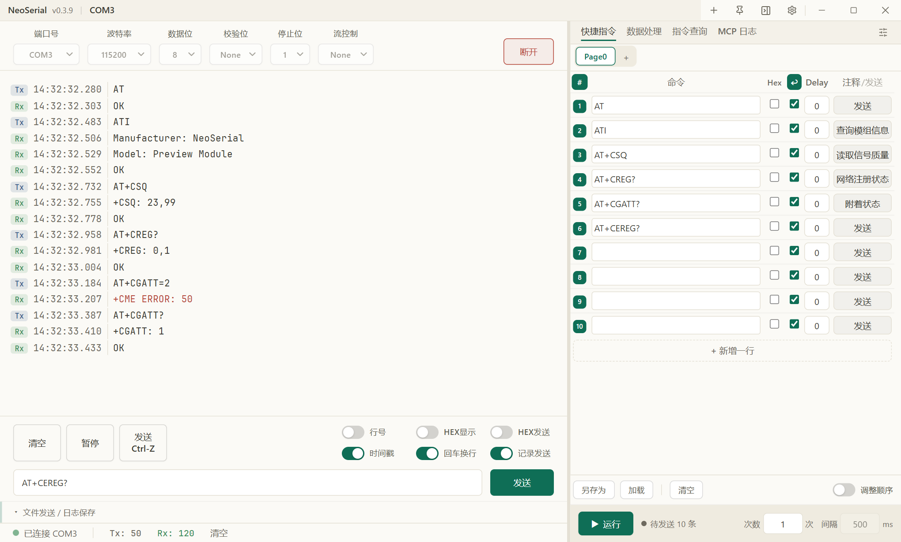

<p align="center">
  
</p>

<h1 align="center">NeoSerial</h1>

<p align="center">
  A Windows serial port debugging tool for cellular modules and embedded development, with a built-in MCP server so you and your AI agent share the same serial connection.
</p>

<p align="center">
  <a href="https://github.com/Alzeros/NeoSerial/releases/latest"></a>
  
  <a href="LICENSE"></a>
</p>

<p align="center">
  <a href="README.md">简体中文</a> | English
</p>

<picture>
  
</picture>

<sub>Ports and logs in the screenshot are simulated.</sub>

> **Note:** the user interface is currently available in Chinese only. UI labels below are translated, with the original Chinese in parentheses where it helps you find them.

## Features

- **Native overlapped I/O**: talks to the Win32 API directly, so a full USB driver buffer never freezes the UI, and line assembly stays stable at high baud rates.
- **One process, many windows**: each window connects to its own port and they send/receive concurrently. Optionally stays in the tray, keeping connections alive after you close the window.
- **AI agent integration**: an embedded MCP (Streamable HTTP) server lets Claude Code, Codex, Cursor, VS Code Copilot and other clients list ports, send/receive, run scripts and look up manuals. Commands sent by the agent show up in the UI, and commands you type are visible to the agent.
- **Quick commands and script sequences**: multi-page command tables with per-row delays, looping, drag-to-reorder and JSON import/export.
- **Data tools**: frame builder (automatic length and CRC/SUM/XOR checksums), codec (GBK/UTF-8/UTF-16, Base64, escaped text), SMS PDU decoding and encoding.
- **AT command suggestions**: hooks up to a knowledge base and suggests commands from module manuals as you type, with syntax, parameter tables and examples. Without a knowledge base it suggests from your send history only.
- **Everyday details**: HEX/ASCII display, timestamps, error keyword highlighting, log search, file sending, log-to-file, CTS/DSR indicators, theme editor, auto update.

## Download

Get it from [Releases](https://github.com/Alzeros/NeoSerial/releases/latest):

| File | Description |
|------|-------------|
| `NeoSerial_<version>_x64-setup.exe` | NSIS installer, **recommended**. Supports auto update; installs WebView2 online if missing |
| `NeoSerial_<version>_x64-portable.exe` | Single portable exe. Requires WebView2 (preinstalled on Windows 11) |

To keep the portable build's settings next to the exe (instead of `%APPDATA%`), put an empty file named `neoserial.portable` in the same folder. See [Configuration and data](#configuration-and-data).

NeoSerial is **single-instance**: launching it again just brings the existing window to the front, rather than starting a second process that would fight over COM ports and the MCP port.

## Quick start

1. In the connection bar at the top, pick a port (hover to see the device name), baud rate and other parameters, then click **Connect (连接)**.
2. Type a command in the input box at the bottom and press Enter or click **Send (发送)**. With **CR/LF (回车换行)** on, CRLF is appended automatically; with **HEX send (HEX发送)** on, the input is sent as hex.
3. Put frequently used commands into the **Quick commands (快捷指令)** table on the right. Send a single row, or run them in batch with a count and interval.
4. The **+** in the title bar opens another window for another port; the gear button opens settings.
5. To let an AI agent drive the port, see [AI agent integration (MCP)](#ai-agent-integration-mcp).

## Features in detail

### Connecting and sending

- Parameters: port, baud rate (add custom presets via "Add… (添加…)" in the dropdown), data bits 5–8, parity None/Odd/Even, stop bits 1/2, flow control None/Software/Hardware.
- The port dropdown shows friendly device names (via SetupAPI, non-USB ports included). The list is de-duplicated and COM names are normalized. While disconnected, it polls for hot-plugged ports every 2 seconds.
- If a port is already open in another window, a hint appears below the connect button.
- Sending: ASCII / HEX, optional CRLF, and **Send Ctrl-Z** (0x1A, used to end input in SMS text mode).
- **Full-width punctuation to half-width** (Settings → General → Send processing / 设置 → 通用 → 发送处理): converts `？，：（）` etc. to ASCII before sending, leaving quoted text untouched. Applies to the input box and quick commands only; MCP sends are passed through as-is.
- File sending: 1024-byte chunks with a progress bar. 100% means the driver has accepted every byte, not merely that data was queued.
- Status bar: connection state, Tx/Rx byte counters (resettable), and CTS/DSR level indicators when hardware flow control is on.

### Log view

- ASCII / HEX toggle, timestamps (`HH:MM:SS.mmm`), line numbers, direction labels (`Tx/Rx` or `发送/接收`), pause, clear.
- Text decoding: ASCII / UTF-8 / GBK (Settings → General → Log content), display only.
- Error keyword highlighting: `ERROR`, `FAIL`, `+CME ERROR`, `+CMS ERROR` by default, editable. Matches received lines only, case-insensitive, takes effect without reconnecting.
- Retention is capped by both line count (1000–10000, default 5000) and raw bytes (1–16 MiB, default 4 MiB); the oldest lines are dropped first. A single oversized record is replaced with a placeholder. Log files on disk are unaffected.
- `Ctrl+F` searches the log (`F3` / `Shift+F3` for next/previous). Copying rebuilds text by line and field, so soft wraps never sneak into the clipboard.
- **Display pause and following are independent.** The existing Pause/Continue action still controls WebUI additions only: records arriving while paused are not backfilled on resume, and serial I/O and file logging are unaffected. Scrolling upward or searching stops following without stopping additions. Return to latest shows the new-record count and resumes following without unpausing. Retention eviction is reported and surviving records keep their reading position where possible.
- **Filter / Tools** is collapsed by default. Combine direction, errors-only, literal case-insensitive include/exclude keywords, and previous/next error navigation. Filters affect the view only, never retained records or continuous log files.
- Enable record selection to select at most two rows and inspect their real timestamp difference; missing timestamps are reported as unavailable. Local markers attach to the first selected or latest row, disappear when cleared/evicted, and never send anything to the device.
- **Copy snippet / Export TXT** includes the selected interval plus 10 original records on each side (configurable 0–1000), including context hidden by filters. With no selection, it exports the filtered view. Text includes timestamps, direction, markers, and a snapshot of current window serial settings; historical records may span connections, so these are not claimed to be historical device parameters. Explicit file export uses a save dialog and does not change global continuous logging.
- Fonts (monospace Latin font and CJK font set separately), font size and line height are adjustable with live preview.

Snippet copying and file export are both limited to 32 MiB of UTF-8 text. Oversized snippets ask you to narrow the range without modifying an existing file.

Connection, send, sequence, configuration and file-logging failures appear as dismissible nonmodal notifications with copyable details. Commands are never automatically resent. A submitted send is not confirmation that the device executed it or returned success.

### Logging to file

- Create/overwrite a file or append to the same one; optionally include sent data.
- Non-printable bytes are written as `\xHH`. The default location is `logs\` under the cache directory.
- Logging is global: all connections write to the same file, and starting/stopping in any window syncs to the others.

### Quick commands and script sequences

- Organized as modules → pages → rows. Each row has: enabled, command, Hex, CR/LF, delay (ms), note. When a row has a note, it is shown on that row's send button.
- Send a single row (or press Enter in its command box), toggle a whole column from the header, drag to reorder in **Reorder (调整顺序)** mode, and use the context menu to rename/delete pages, edit notes or delete rows.
- Batch run: set a repeat count and loop interval, watch progress and the remaining count, stop at any time. A disconnect aborts the run and records the row it stopped at.
- Saved automatically; you can also **Save as (另存为)** / **Load (加载)** JSON. Font size, row height and font of the editor are adjustable (Settings → Extensions → Quick commands).

### Data tools

The **Data processing (数据处理)** tab on the right holds three tools, each of which can be hidden in settings:

- **Frame builder**: fixed four-part layout `[header][length][data][checksum]`.
  - Length field: none / 1 byte / 2 bytes, little or big endian, covering data / data + checksum / whole frame.
  - Data source: manual input, random characters (pick character classes and minimum counts), random bytes, all 00, all FF, incrementing, custom repeating pattern.
  - Checksum: CRC16 (Modbus / CCITT-FALSE / XModem / ARC), CRC32, SUM8, XOR8, optionally covering the header and length.
  - Live preview; send directly, fill into the input box, or save as a template. Max 64 KiB per frame.
- **Codec**: text ⇄ Hex, Base64 encode/decode, escaped text ⇄ Hex (`\r \n \t \0 \xHH`, etc.). Encodings: UTF-8 / GBK / UTF-16LE / UTF-16BE, with GBK handled natively.
- **SMS**:
  - Decode PDU: accepts `+CMGR` / `+CMT` / `+CMGL` output; paste several parts of a concatenated SMS to decode them together.
  - Encode PDU: GSM 7-bit / UCS-2 / auto, with SMSC address, validity period and concatenated-SMS splitting (up to 255 parts), plus the matching `AT+CMGS=<length>`.

### Command suggestions and command lookup

This needs a knowledge base service that serves a "manual AT command index" (HTTP endpoints `GET /api/v1/commands/documents` and `GET /api/v1/commands?document_id=&page=&page_size=`, authenticated with an `X-API-Key` header). Without one, suggestions come from send history only.

- **Setup**: Settings → Extensions → Command suggestions (指令联想). Enter the server URL and API key, then click **Refresh command index (刷新指令库)**. Commands are cached locally, optionally refreshed on startup.
  - The API key is stored encrypted with DPAPI and never written to `settings.json`.
  - Refreshing is incremental: a manual is reused from cache when its `updated_at` and command count are unchanged. A single manual can be force-refreshed.
  - Manuals are grouped by their knowledge base groups, and you can choose which manuals take part in suggestions.
- **Input box suggestions**: by default the popup appears once you have typed 2 characters after the `AT+` prefix; the threshold is configurable. Matching is case-insensitive, so `csq` finds `AT+CSQ`, and Chinese names are searchable too.
  - Candidates show the Chinese name, syntax, parameter table, examples, source manual and page. A command found in several manuals is merged into one entry, and you can switch between each manual's version.
  - Send history matches by prefix and ranks above manual candidates. Each has its own limit (20 manual / 10 history by default), so neither crowds out the other.
  - Keyboard: `↑` enters the list and selects the best match, keep pressing `↑` to move up, `↓` to move back; `Tab` or Enter on a highlighted item fills it in without sending; `Esc` closes the list. Enter with nothing highlighted sends as usual. With an empty input box, `↑` browses send history.
- **Command lookup tab (指令查询)**: fuzzy-search manual commands in the right panel, browse with the keyboard, and click an example line to fill it into the input box.

### Multiple windows and background mode

- Click **+** in the title bar for a new window. All windows are equal; there is no "main window". Connections do not belong to windows; a window is just a view of a connection.
- Connections opened by an agent, or left behind by a closed window, put a red dot on **+**. Hover to list them, click one to open a window attached to it with its history backfilled.
- **Stay in tray (托盘常驻)** (Settings → General → Background and exit, off by default):
  - **On**: closing a window keeps its connection alive, still receiving, logging and running sequences. Closing every window leaves the app in the tray with MCP still available. The tray menu can open a new window, open or switch to a connection, or quit.
  - **Off**: closing a window disconnects the connections it opened (agent-opened ones are handed back to the agent); closing the last window quits. If an agent connection is still alive at that point, you are asked to confirm first.

### Appearance

- 4 preset themes (3 light, 1 dark) plus a custom theme editor: edit colors by category, preview live in the main window, hover to highlight the affected area, import/export JSON.
- Frameless window with a custom title bar (new window, always on top, collapse side panel, settings), custom context menus and dropdowns.

### Auto update

- Automatic checks are on by default (at most once a day; turn off under Settings → About). When a new version exists, a hint appears next to the version number in the title bar; you can snooze it (7 days) or ignore that version, or check manually under Settings → About.
- Updates come from a self-hosted mirror `dl.neo.loc.cc` (reachable from mainland China) first, falling back to GitHub Releases. Packages are verified with minisign signatures, and the app restarts after installing.

### Keyboard shortcuts

| Key | Action |
|-----|--------|
| `Enter` | Send (fills in instead when a suggestion is highlighted) |
| `↑` / `↓` / `Tab` / `Esc` | Navigate / fill in / close suggestions; `↑` on an empty input opens send history |
| `Ctrl+F`, `F3` / `Shift+F3` | Search the log, jump to next/previous match |
| `Ctrl+A` | Select all within the focused area only (log, MCP log, command details) |

## AI agent integration (MCP)

On startup NeoSerial runs an MCP (Streamable HTTP) server on `127.0.0.1`, port `34594` by default, moving up if that port is taken. NeoSerial always owns the serial port and agents never open it directly, so you and the agent can work on the same connection at the same time.

### Adding it to your client

The easiest way is the setup guide under **Settings → Extensions → MCP service (MCP 服务)**: pick your client and scope, copy the command or config, then use the local self-check (本机服务自检) to confirm the server is up. User-level configs are below (use the port shown in settings):

<details>
<summary>Claude Code</summary>

```bash
claude mcp add --scope user --transport http neoserial http://127.0.0.1:34594/mcp
```
</details>

<details>
<summary>Codex</summary>

```bash
codex mcp add neoserial --url http://127.0.0.1:34594/mcp
```

Or merge into `~/.codex/config.toml`:

```toml
[mcp_servers.neoserial]
url = "http://127.0.0.1:34594/mcp"
```
</details>

<details>
<summary>Cursor (<code>~/.cursor/mcp.json</code>)</summary>

```json
{ "mcpServers": { "neoserial": { "url": "http://127.0.0.1:34594/mcp" } } }
```
</details>

<details>
<summary>VS Code Copilot (<code>.vscode/mcp.json</code> or user configuration)</summary>

```json
{ "servers": { "neoserial": { "type": "http", "url": "http://127.0.0.1:34594/mcp" } } }
```
</details>

Other clients: choose the Streamable HTTP transport, name it `neoserial`, and use the URL above.

To verify, send this to your client:

> Call NeoSerial's list_ports and list the available serial ports. Only read the port list: do not connect to any port and do not send data. If the tool is unavailable, say so instead of guessing.

The **MCP log (MCP 日志)** tab on the right shows every tool call from the agent in real time (tool, arguments, success, duration).

### Tools (19)

Tool execution results return `{ ok: bool, ... }`: `ok=false` includes an `error` reason (in Chinese) and sets `isError=true`; successful results set `isError=false`. Text JSON and `structuredContent` contain the same payload. Malformed argument structures (such as missing required fields or incorrect field types) and unknown tool names return JSON-RPC error `-32602`, without a tool `result`.

| Tool | Description |
|------|-------------|
| `list_ports` | List available serial ports |
| `connect` / `disconnect` | Connect / disconnect. A port already open in the GUI or by an earlier call is reused, returning `reused`, the actual `baud` and `owner` (gui / agent) |
| `get_status` | Connection state, byte counters, current sequence number; `cts` / `dsr` with hardware flow control |
| `send` | Send only, without reading a response |
| `send_and_read` | Send, then block reading the response; `timeout_ms` is a silence-gap timeout, and only received lines are returned |
| `get_history_since` | Fetch Tx/Rx history after a sequence number (with direction and `ts` / `ts_ms` timestamps); truncated results can be resumed without losing lines |
| `reset_stats` | Reset byte counters |
| `send_file` | Send a file, binary-safe for firmware flashing; blocks until everything is written |
| `start_logging` / `stop_logging` | Start / stop logging to file |
| `sequence_run` / `sequence_stop` / `get_sequence_status` | Script sequences: batch commands + loops + delays, with pollable progress |
| `get_settings` / `save_settings` | Read / write settings |
| `kb_search` / `kb_get` / `kb_manuals` | Query the locally cached manual AT commands: search, get the full record (syntax/parameters/examples), list manuals. Never calls the knowledge base, so no quota is used |

### Conventions for agents

- **Finding the instance**: read `%APPDATA%\neoserial\mcp-registry.json` (fixed path, also used in portable mode) and take an entry whose `heartbeat_at` is within the last 30 seconds; use its `port`. `connections` lists the open COM ports and their baud rates. No fresh entry means NeoSerial is not running: start it and wait for it to register, or probe ports upward from 34594 with `get_status`.
- **Baud rate mismatches are errors**: calling `connect` on an already-open port with a different baud rate fails instead of silently keeping the old one. Changing the baud rate requires `disconnect` first, which drops the connection the user is working on, so ask the user before doing it.
- **Reconnecting**: connecting to the same port right after `disconnect` can, in rare cases, report "port in use" because the driver has not released it yet. Wait 0.5–1 s and retry.
- **Enum parameters** (`ending`, `data_bits`, `parity`, `flow_control`) are case-insensitive, but invalid values are rejected rather than silently replaced with defaults.
- **Check the manual before sending**: look up syntax with `kb_search` / `kb_get`. `also_in_count > 0` means different manuals have different versions, so check `also_in` from `kb_get` before following a syntax.

> The MCP server listens on loopback only and has no authentication, so any local process can call it. It also enforces Origin validation: every request carrying an `Origin` header (i.e. any browser context, including DNS rebinding) is rejected with 403, and only native MCP clients without an Origin (Claude Code / Codex / Cursor / VS Code, etc.) can connect — in-browser MCP clients are not a supported entry point. Turn it off in settings if you don't need it (takes effect after restart).
>
> Under overload: normal HTTP admission is limited to 32 concurrent requests; saturation returns `429` with `Retry-After: 1`. `list_ports`, `get_status`, `get_sequence_status`, `disconnect`, and `sequence_stop` have four additional reserved HTTP slots, so modern stateless requests and recovery calls on existing legacy sessions can still enter while normal long-running calls fill the entry point. A full reserve also returns `429`. Reserved admission checks the actual body method and tool name rather than trusting headers alone, and retains all Origin, Host, and protocol-metadata validation. Probe bodies are limited to 4 MiB (`413` on overflow) and a one-second read deadline (`408` on timeout). Recovery tools also have a separate tool-execution quota.
>
> A full tool-execution quota returns an `isError=true` busy result explicitly stating that the call was not executed; that rejection is safe to retry. **Do not infer absence of device side effects or safe replay from `isError=true` alone**: execution failures and cancellation also set the error flag. Never blindly resend serial commands that may already have been sent or files that may have been partially written. Check `sent`, `cancelled`, `retryable`, and the error explanation; resume reading or confirm device state manually when needed.

## Configuration and data

Data lives in two places: the **config directory** (default `%APPDATA%\neoserial`) holds settings and your content, and the **cache directory** (default `%LOCALAPPDATA%\neoserial`) holds rebuildable or large files. The cache directory is not synced with roaming profiles. Both can be viewed and opened under Settings → General → Data directories.

| File | Location | Contents |
|------|----------|----------|
| `settings.json` | config | Serial defaults, UI preferences, theme, error keywords, baud presets, MCP, command suggestions, update checks, etc. |
| `sequence.json` | config | Quick command modules, data tool configs and templates |
| `send-history.json` | config | Input box send history (200 entries by default, adjustable 50–1000) |
| `kb-credential.dat` | config | Knowledge base API key, encrypted with the current Windows user's DPAPI |
| `command-index.json` | cache | Manual command cache, rebuildable by refreshing |
| `logs\` | cache | Default log file location |
| `mcp-registry.json` | **fixed** `%APPDATA%\neoserial` | MCP port and open ports, for agents to discover the instance |

- **Portable mode**: put an empty file `neoserial.portable` next to the exe and config, cache and WebView2 data all go to `<exe folder>\data`. The `NEOSERIAL_DATA_DIR` environment variable does the same with higher priority. Both are read at startup only; existing data is not moved automatically.
- **The registry does not move with portable mode**: it is the agreed location for agents to find the instance. Entries carry a heartbeat and readers check freshness, so a copy roamed to another machine cannot mislead an agent.
- A corrupted config file is renamed to `.bad` as a backup and defaults are used. Files are written to a temp file first and then renamed, so a power loss never leaves half a JSON file.
- When several windows, an agent and the theme editor change settings at once, each submits only the fields it changed, so they don't overwrite each other.

## Development

### Requirements

- Windows 10/11 x64 with WebView2
- [Rust](https://rustup.rs/) stable (MSVC toolchain) and the Tauri 2 [prerequisites](https://v2.tauri.app/start/prerequisites/)
- Node.js: 20+ is enough to build the frontend; `npm run test:unit` relies on Node's native TypeScript type stripping and needs **22.18 or later**
- Chrome or Edge installed locally for the browser regression tests

### Build

```bash
npm install
npm run tauri dev                       # dev mode (Vite + Cargo, frontend hot reload)
npm run tauri build                     # release build: NSIS installer + signed update artifacts
npm run tauri build -- --no-bundle      # compile the exe only, no installer
```

`tauri.conf.json` enables signed updater artifacts, so building an installer requires `TAURI_SIGNING_PRIVATE_KEY` (and `TAURI_SIGNING_PRIVATE_KEY_PASSWORD`); otherwise the bundling step fails. For local use, add `--no-bundle`; the output `src-tauri/target/release/neoserial.exe` runs directly.

The code keeps a `serialport` fallback path for non-Windows platforms, but only Windows builds are released and tested.

### Injecting a default knowledge base at build time (optional)

Set these two environment variables at build time and they are compiled into the binary as fallbacks, so users on an intranet get command suggestions without entering a URL and key. Values entered in settings take precedence.

```bash
NEOSERIAL_KB_BASE_URL=http://kb.intranet:8200
NEOSERIAL_KB_API_KEY=kb_xxxxxxxx
```

- Injected values are never written to config files or sent to the UI: the settings page only shows "built in (leave empty to use)", and neither `get_settings` nor devtools can read them. Clearing the input box reverts to the built-in value.
- Unset means not configured, so suggestions use send history only. CI reads GitHub Secrets of the same names. Locally you can use the `[env]` section of `src-tauri/.cargo/config.toml` (gitignored):
  ```toml
  [env]
  NEOSERIAL_KB_BASE_URL = "http://kb.intranet:8200"
  NEOSERIAL_KB_API_KEY = "kb_xxxxxxxx"
  ```
  TOML needs quotes, but the GitHub Secret field and shell `export` must **not** include them. If quotes slip in anyway, `clean_injected` strips the outer pair.
- Changing the variables requires a rebuild (`build.rs` declares `rerun-if-env-changed`).
- **An injected key ships inside the binary and is visible with `strings`.** Secrets keep the key out of git history, not out of the installer. Use this only for read-only intranet APIs; the real fix is for the client not to hold a long-lived key.

### Tests

```bash
cd src-tauri && cargo test     # Rust unit tests
npm run test:unit              # frontend pure-function and source contract tests (node --test, Node ≥ 22.18)
npm run check                  # svelte-check type checking
npm run test:ui                # UI regressions: quick command table, send area switches, window layout
npm run test:persistence       # persistence regressions: panel autosave, concurrent settings saves
npm run test:logs              # log follow/pause, diagnostics/export, copy, retention and performance
npm run test:notifications     # failure feedback, deduplication, copy-details and window isolation
```

- The frontend browser regressions above need neither Rust nor a serial device: they start a temporary Vite server and an isolated headless Chrome/Edge with mocked IPC, and never touch your real config. If the browser is not found, point `BROWSER_BINARY` at its executable.
- `npm run test:ui -- --screenshots <dir>` also writes light, dark and minimum-size screenshots (simulated data).
- `tests/browser/` contains more per-feature regression scripts:
  - Using the same headless setup, runnable directly with `node tests/browser/<name>.mjs`: `com-selection`, `log-diagnostics`, `log-regressions`, `notifications`, `mcp-setup`, `motion-regressions`, `settings-groups`, `settings-help`, `settings-reuse`, `settings-scrollbar`, `settings-shortcuts`, `titlebar-layout`, `update-reminder`.
  - The rest (`codec-*`, `log-*`, `mcp-settings`, `port-tip`, `settings-close`, `theme-window`) need Vite and a remote-debugging browser started by hand, or a **disposable** native instance (its own `NEOSERIAL_DATA_DIR`, with WebView2 remote debugging on). See each script's header comment, and never run them against your everyday profile.

### Releasing

1. Bump the version in `package.json`, `src-tauri/Cargo.toml`, `src-tauri/tauri.conf.json`, and the fallback version text in `src/components/SettingsDialog.svelte` and `src/components/UpdaterCard.svelte`. Commit the updated `package-lock.json` and `Cargo.lock` too.
2. Update `releaseBody` (the release notes) in `.github/workflows/release.yml`.
3. Push a `v*` tag. CI builds and signs the NSIS installer, generates `latest.json`, uploads the portable exe, then syncs the installers and a `latest.json` with rewritten download URLs to the mirror server.

Required Secrets:

| Secret | Purpose |
|--------|---------|
| `TAURI_SIGNING_PRIVATE_KEY` / `TAURI_SIGNING_PRIVATE_KEY_PASSWORD` | Update package signing (required) |
| `NEOSERIAL_KB_BASE_URL` / `NEOSERIAL_KB_API_KEY` | Build-time default knowledge base (optional; nothing is injected if unset) |
| `SERVER_SSH_KEY_B64` / `MIRROR_HOST` / `MIRROR_USER` / `MIRROR_PATH` | Mirror sync (optional; a failure here does not fail the release) |

### Tech stack and architecture

Frontend: Svelte 5 + TypeScript + Tailwind CSS + Vite. Backend: Rust + Tauri 2 + windows-sys (overlapped I/O) + crossbeam-channel + rmcp (MCP). For the threading model, data path, multi-window event routing, MCP internals and directory layout, see [ARCHITECTURE.md](ARCHITECTURE.md) (in Chinese).

## Known limitations

- Windows x64 only.
- Timestamps are always shown in UTC+8 (`src-tauri/src/util/time_fmt.rs`).
- Logging to file uses one global file, so output from several connections logged at once is interleaved.
- The MCP server has no authentication (see above).

## License

[MIT](LICENSE)
